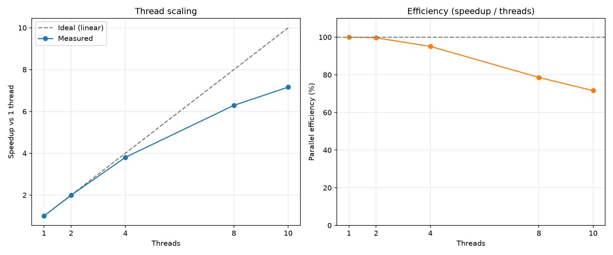
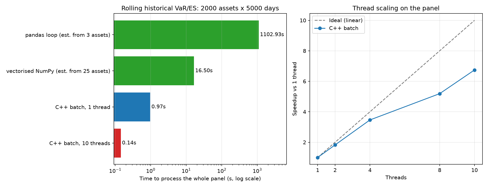

# Credit and Market Risk Toolkit (C++ / Python)

A tested C++20 library with Python bindings for two jobs in risk management: a multithreaded
Monte Carlo engine for portfolio credit losses (the Vasicek one-factor model behind the Basel
IRB capital formula), and rolling VaR / Expected Shortfall forecasts with the standard
backtests. A pandas wrapper lets existing Python code switch to the C++ with a one-line import.

**Highlights**

- Credit engine: about 7x faster than a single-core vectorised NumPy simulation on a 10-core
  Mac, with identical results for any thread count, converging to the closed-form Basel IRB
  value as portfolios become granular
- Rolling historical VaR/ES: about 17x faster than vectorised NumPy on one thread and about
  115x on 10 threads, on a 2,000-asset panel
- Every C++ function is checked against independent Python implementations (the original
  pandas code, to about 1e-14), by 42 unit tests and equivalence checks that run in CI
- Quantifies what the IRB formula ignores: with 40% of exposure in 10 loans, the 99.9% VaR is
  about 20% above the IRB figure

## What is inside

| Component | What it does |
|---|---|
| Credit loss engine | Vasicek one-factor Monte Carlo, multithreaded, reproducible; Basel IRB asymptotic formula |
| VaR / ES models | Rolling historical, normal and EWMA VaR and Expected Shortfall |
| Batch kernel | The same models over many assets at once, in parallel across assets |
| Backtests | Kupiec, Christoffersen independence, conditional coverage, Basel traffic light, ES ratio, FZ0 score |
| `fast_risk` | pandas wrapper with the same function names and return types as the original pandas code |

Not included: GARCH and Student-t models (they need Python's `arch` package for fitting),
portfolio-level VaR, pricing and stress testing.

## Install

Requires a C++20 compiler, CMake 3.18+ and Python 3.9+.

```bash
python3 -m venv .venv
source .venv/bin/activate
pip install -r requirements.txt
cmake -S . -B build -Dpybind11_DIR=$(python -m pybind11 --cmakedir)
cmake --build build -j
ctest --test-dir build --output-on-failure
```

The build puts the Python module `creditmc_core` into `python/`. Run the examples below from
that folder, or add it to `PYTHONPATH`.

## Quick start

Credit losses:

```python
import numpy as np
import creditmc_core as cc

n = 1000                                   # equal obligors: PD 2%, exposure 1, LGD 45%
losses = cc.simulate(np.full(n, 0.02), np.ones(n), np.full(n, 0.45),
                     0.15, 1_000_000, seed=1)          # asset correlation 0.15
print(np.quantile(losses, 0.999))          # 99.9% VaR of the portfolio loss
print(n * cc.irb_asymptotic_loss(0.02, 0.45, 0.15, 0.999))   # Basel IRB figure
```

Market risk, with pandas:

```python
import pandas as pd
import fast_risk

prices = pd.read_csv("prices.csv", index_col="Date", parse_dates=True)
returns = fast_risk.to_returns(prices["SPY"])
forecast = fast_risk.historical(returns, window=250, alpha=0.01)   # DataFrame: VaR, ES
print(fast_risk.summarize(returns, forecast, 0.01))                # hits, Kupiec, ES ratio, FZ0 ...

# Many assets at once, in parallel across assets
all_returns = pd.DataFrame({c: fast_risk.to_returns(prices[c]) for c in prices.columns})
forecasts = fast_risk.var_es_panel(all_returns, model="historical", window=250, alpha=0.01)
```

To switch existing code that uses `historical`, `normal`, `ewma` and the backtests from
`models.py` and `backtest.py`, change the imports to `from fast_risk import ...`.

## Results

Timings are medians of repeated runs on a 10-core Apple Silicon laptop.

### Credit engine

**Speed and thread scaling** (1,000 obligors, 200,000 scenarios): 2.0x on 2 threads, 3.8x on 4
(95% efficiency), 6.3x on 8 and 7.2x on 10, versus 1 thread. Single-thread speed is on par with
NumPy, so the 7.0x advantage over NumPy at 10 threads comes from parallelism. Results are
identical at every thread count.



**Concentration effect** (1,000 obligors, 1M scenarios, PD 2%, LGD 45%, rho 0.15, total exposure
fixed). The IRB formula gives one VaR for every row because it ignores concentration:

| Top-10 share of exposure | MC VaR (99.9%) | MC / IRB | ES (99.9%) |
|---|---|---|---|
| 1% (equal loans) | 79.65 | 1.004 | 93.96 |
| 10% | 80.18 | 1.011 | 95.10 |
| 20% | 83.09 | 1.047 | 98.49 |
| 30% | 88.55 | 1.116 | 104.23 |
| 40% | 95.18 | 1.200 | 112.00 |

IRB VaR is 79.35 in every row. With 40% of exposure in 10 loans, simulated tail risk is about
20% above the IRB figure.


**Correlation sweep** (1,000 equal obligors, 1M scenarios x 5 runs per point). Monte Carlo VaR
tracks the IRB formula closely; the excess over IRB is about 4% at rho = 0.05 and falls to about
1% for rho >= 0.175 (error bars are standard errors over 5 runs).


**Convergence to IRB** (equal obligors, total exposure fixed, rho 0.15). As the number of obligors
grows, Monte Carlo VaR converges to the Basel value, which assumes infinitely many obligors: the
ratio falls from 1.04 at N = 250 to about 1.00 at N >= 2,000, and the excess is consistent with
scaling as 1/N. At small N the loss distribution is discrete, so the N = 250 error bar understates
the true uncertainty.


### Market-risk module

**Correctness.** On the author's 7-asset daily dataset (SPY, KRE, JPM, AAPL, TSLA, ES3.SI,
BTC-USD) at 95% and 99%, the C++ VaR and ES forecasts match the original pandas code to about
1e-17, and every backtest statistic matches. A full ML forecasting pipeline run on the wrapper
reproduced its results files to about 1e-14, with the same hit counts and the same missing values.

**Speed** (rolling historical VaR/ES, 2,000 assets x 5,000 days, window 250, 99%):

| Method | Time for the panel | vs vectorised NumPy |
|---|---|---|
| pandas loop (estimated from 3 assets) | 1,103 s | |
| vectorised NumPy (estimated from 25 assets) | 16.5 s | 1x |
| C++ batch, 1 thread | 0.97 s | 17x |
| C++ batch, 10 threads | 0.14 s | 115x |

The two Python baselines are timed on a sample and extrapolated; the C++ rows process the whole
panel, including copying data in and out of Python. The NumPy version is a straightforward
vectorisation (it does not use threads). Across threads the panel scales 1.8x on 2, 3.5x on 4,
5.2x on 8 and 6.7x on 10, with results identical at every thread count. Each asset is a very short
task (about 0.5 ms), so scaling is lower than for the credit engine.



The normal and EWMA models are already fast in pandas (milliseconds per asset), so the C++
versions are about equal there. The speed-up is in the historical model, which uses a sliding
sorted window instead of re-sorting every window.

## Testing

- **42 unit tests** (Catch2): normal-distribution functions against SciPy, the IRB formula,
  input validation, thread-count independence, hand-worked VaR/ES examples, statistical checks
  of the simulation, and a brute-force comparison of the sliding-window kernel on tied data.
  Reference numbers come from independent Python code, not from the C++.
- **Equivalence checks** (`python/check_*.py`) compare the C++ with the original pandas code on
  synthetic data, edge cases and the real dataset. They run in CI.
- **CI** builds and tests on Linux and macOS for every push and checks that the Python module
  builds and passes the equivalence checks.
- Tests were also checked by introducing deliberate bugs and confirming they fail.

## Limitations

- Credit model: one systematic factor, one correlation shared by all obligors, a one-period
  horizon and constant LGD
- The 99.9% VaR rests on few tail scenarios, so results are noisy unless the scenario count is
  large; the experiments average several seeds and report standard errors
- The Basel traffic light is only meaningful for 99% VaR over 250 days
- The C++ rejects non-finite returns and invalid arguments with an error, where the original
  pandas code would quietly produce NaN
- The compiled module only loads in the Python version it was built with

## Layout

- `include/creditmc/`, `src/`: engine, VaR/ES models, backtests and the pybind11 bindings
- `tests/`: Catch2 unit tests
- `python/fast_risk.py`: pandas wrapper
- `python/reference_*.py`: reference implementations used by the checks
- `python/check_*.py`: equivalence checks against the reference code
- `python/compare.py`, `concentration.py`, `plot_*.py`, `benchmark_*.py`: experiments and benchmarks
- `.github/workflows/ci.yml`: continuous integration

